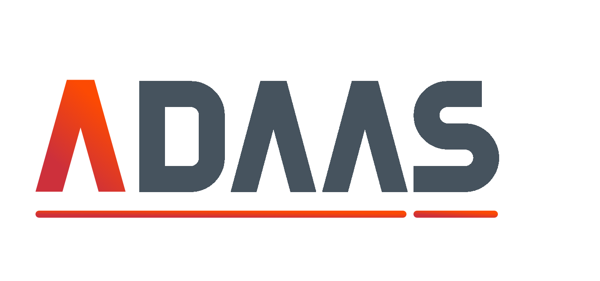

# A-Concept Rendering Engine


[](https://www.npmjs.com/package/@adaas/are)
[](./LICENSE)
[](https://github.com/ADAAS-org/adaas-are/actions)

**ARE** is a declarative, signal-driven rendering engine built on top of the [A-Concept](https://github.com/ADAAS-org/adaas-a-concept) framework. It provides a full pipeline — tokenization, compilation, transformation, interpretation, and lifecycle management — for building dynamic, component-based UIs.

---

## Table of Contents

- [Installation](#installation)
- [Quick Start](#quick-start)
- [Core Concepts](#core-concepts)
  - [Are (component base)](#are-component-base)
  - [AreEngine](#areengine)
  - [AreLoader](#areloader)
  - [AreTokenizer](#aretokenizer)
  - [AreCompiler](#arecompiler)
  - [AreInterpreter](#areinterpreter)
  - [AreScene & AreStore](#arescene--arestore)
  - [AreSignals](#aresignals)
  - [AreNode & AreAttribute](#arenode--areattribute)
  - [AreLifecycle](#arelifecycle)
  - [HTML Engine](#html-engine)
- [API Reference](#api-reference)
- [Building](#building)
- [Testing](#testing)
- [License](#license)

---

## Installation

```bash
npm install @adaas/are
```

**Peer dependencies** (must be installed separately):

```bash
npm install @adaas/a-concept @adaas/a-frame @adaas/a-utils
```

---

## Quick Start

ARE is rendered by `@adaas/are-html`; install both. A complete, tested app (UI + API + docker-compose) lives in
`adaas-composer-new/starter/`.

```bash
npm install @adaas/a-concept @adaas/a-utils @adaas/a-frame @adaas/are @adaas/are-html
```

Boot (browser):

```typescript
import { A_Concept } from '@adaas/a-concept';
import { A_Config, ConfigReader } from '@adaas/a-utils/a-config';
import { A_Logger } from '@adaas/a-utils/a-logger';
import { A_SignalBus, A_SignalState } from '@adaas/a-utils/a-signal';
import { A_Polyfill } from '@adaas/a-utils/a-polyfill';
import { AreContainer, AreInit } from '@adaas/are';
import { AreDirectiveFor, AreDirectiveIf, AreHTMLEngine, AreHTMLEngineContext, AreRoot } from '@adaas/are-html';
import { MyButton } from './MyButton.component';

const container = new AreContainer({
    name: 'MyApp',
    // the app's components + every directive its templates use + the engine
    components: [MyButton, AreDirectiveIf, AreDirectiveFor, A_SignalBus, AreRoot, ConfigReader, AreHTMLEngine, A_Logger],
    entities: [AreInit],
    // every signal type dispatched must be listed in A_SignalState
    fragments: [new A_SignalState([AreInit]), new AreHTMLEngineContext({ container: document }), new A_Config({ defaults: {} })],
});
const concept = new A_Concept({ name: 'my-app', components: [A_Logger, ConfigReader, A_Polyfill], containers: [container] });
await concept.load();
await concept.start();
```

```html
<are-root id="app"><my-button></my-button></are-root>
<script type="module" src="/app.js"></script>
```

A component (its tag is the kebab-cased class name: `MyButton` → `<my-button>`):

```typescript
import { A_Caller, A_Inject } from '@adaas/a-concept';
import { Are, AreNode, AreStore } from '@adaas/are';

export class MyButton extends Are {

    @Are.Template
    template(@A_Inject(A_Caller) node: AreNode) {
        node.setContent(`<button type="button" @click="$press">{{label}} · {{count}}</button>`);
    }

    @Are.Data
    data(@A_Inject(AreStore) store: AreStore) {
        store.set({ label: 'Click me', count: 0 });
    }

    @Are.EventHandler
    press(@A_Inject(AreNode) node: AreNode, @A_Inject(AreStore) store: AreStore) {
        store.set({ count: Number(store.get('count')) + 1 });
    }
}
```

Bundle with esbuild (`bundle: true`, `format: 'esm'`, `keepNames: true` — tags come from class names) and
`experimentalDecorators` in tsconfig. Keep ONE copy of `@adaas/are` and `@adaas/a-concept` in the bundle.

---

## Core Concepts

### Are (component base)

`Are` is the base class for all ARE-managed UI components. It exposes decorators that map to the rendering lifecycle:

| Decorator | Description |
|---|---|
| `@Are.Template` | Renders the component HTML |
| `@Are.onAfterInit` | Called after the component is initialized in scope |
| `@Are.onAfterMount` | Called after the component is mounted to the DOM |
| `@Are.Signal` | Called when a signal vector arrives |
| `@Are.Data` | Reactive data binding |

### AreEngine

`AreEngine` orchestrates the full rendering pipeline for a given scope. It coordinates loading, tokenization, compilation, transformation, and interpretation phases and emits `AreInit` when the initial render is complete.

### AreLoader

`AreLoader` is responsible for loading the source template (HTML string or remote URL) into the rendering context prior to tokenization.

### AreTokenizer

`AreTokenizer` scans the template source using the `AreSyntax` rules and produces an array of `AreNode` instances that form the template AST.

### AreCompiler

`AreCompiler` traverses the tokenized AST and compiles each node — resolving attributes, directives, interpolations, and event listeners — into a form ready for the transformer.

### AreInterpreter

`AreInterpreter` applies compiled `AreInstruction` objects against the host environment (e.g. DOM) to produce the final rendered output.

### AreScene & AreStore

`AreScene` is a reactive state fragment that tracks the current set of `AreInstruction` objects applied to the rendered output. `AreStore` holds the reactive data model that instructions reference during rendering and updates.

### AreSignals

The signal sub-system provides reactive communication across the component tree:

- **`AreSignals`** — central signal bus that dispatches `A_SignalVector` events to subscribed nodes
- **`AreSignalsContext`** — fragment that holds the set of subscribed root nodes
- **`AreInit`** — signal emitted when the engine completes the initial render
- **`AreRoute`** — signal emitted on route changes
- **`AreSignal`** — base class for custom signals

### AreNode & AreAttribute

`AreNode` is the base entity for all nodes in the template AST. `AreAttribute` holds parsed attribute data (name, value, binding type) attached to a node.

### AreLifecycle

`AreLifecycle` manages mount / unmount / update lifecycle phases for the component tree, calling the appropriate lifecycle hooks on each `AreNode`.

### HTML Engine

The `engines/html` sub-package provides a concrete HTML-DOM implementation of the ARE pipeline:

| Export | Description |
|---|---|
| `AreHTMLEngine` | Entry point — wires all HTML pipeline pieces into a scope |
| `AreRoot` | Root host component mounted at the target DOM element |
| `AreHTMLNode` | Base class for all HTML-aware node types |
| `AreHTMLCompiler` | HTML-specific compilation pass |
| `AreHTMLTokenizer` | HTML syntax tokenizer |
| `DOMInterpreter` | Applies instructions to the real DOM |

---

## API Reference

All public exports are available from the package root:

```typescript
import {
    // Core
    Are, AreContext,
    // Pipeline
    AreEngine, AreLoader, AreTokenizer, AreCompiler, AreTransformer, AreInterpreter,
    // AST
    AreNode, AreAttribute,
    // State
    AreScene, AreStore,
    // Instructions
    AreInstruction, AreDeclaration, AreMutation,
    // Lifecycle
    AreLifecycle, AreWatcher,
    // Signals
    AreSignal, AreSignals, AreSignalsContext, AreInit, AreRoute,
    // Syntax
    AreSyntax,
    // HTML engine (re-exports)
    AreHTMLEngine,
} from '@adaas/are';
```

---

## Building

```bash
npm run build
```

Produces:
- `dist/browser/` — ESM bundle targeting modern browsers
- `dist/node/` — CJS + ESM bundle for Node.js

---

## Testing

```bash
npm test
```

---

## License
This project is licensed under the Apache License 2.0.

© 2026 ADAAS YAZILIM LİMİTED ŞİRKETİ. All rights reserved.
All original code and concepts are the intellectual property of ADAAS YAZILIM LİMİTED ŞİRKETİ.

